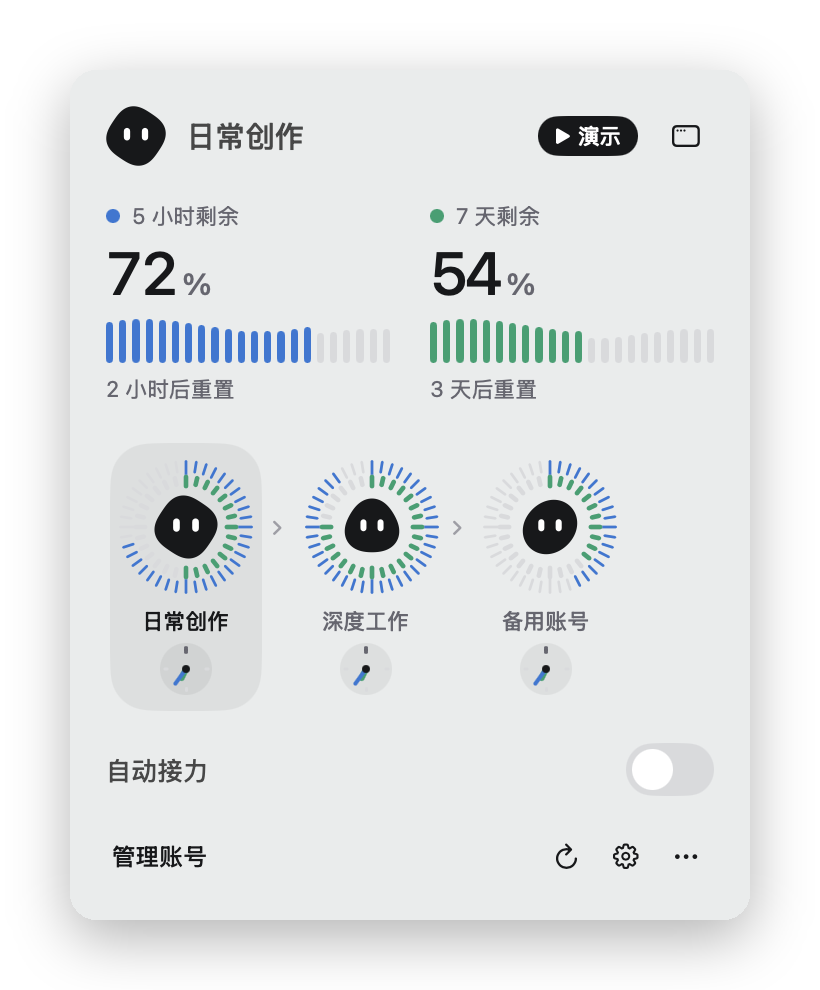
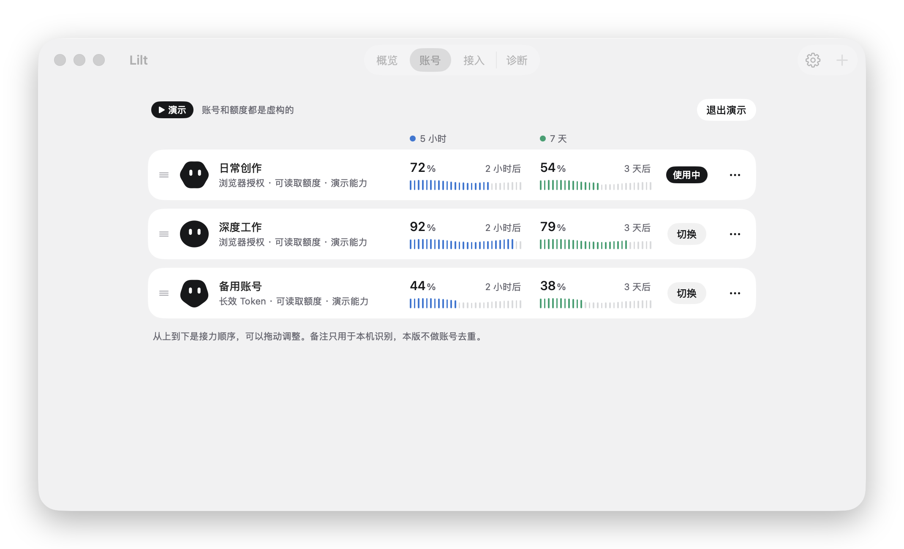
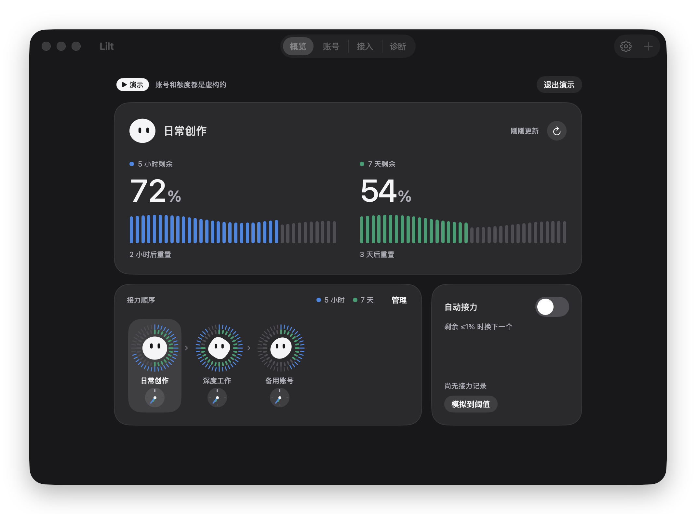

<p align="center">
  <picture>
    <source media="(prefers-color-scheme: dark)" srcset="assets/brand/lilt-logo-light.svg">
    
  </picture>
</p>

# Lilt

**一台 Mac 上管理多个 Claude Pro / Max 账号：看额度、一键换号，额度用完自动接力。**

macOS 菜单栏小工具。你照常在终端里用官方 `claude`，Lilt 负责告诉你每个账号还剩多少额度，并在需要时把 Claude Code 的登录换成下一个账号。

<p align="center">
  
</p>

<p align="center"><sub>演示模式：账号和额度都是虚构的。“日常创作”的额度到了阈值，Lilt 自动换到“深度工作”。</sub></p>

## 它能做什么

- **一眼看额度**：每个账号的 5 小时和 7 天额度各剩多少、什么时候重置，蓝色是 5 小时，绿色是 7 天。
- **一键换号**：点一下账号，终端里的 `claude` 就用上它，不需要重新登录，也不需要特别的启动命令。
- **自动接力**：打开后，当前账号的 5 小时或 7 天额度剩余到了各自的阈值（默认都是 1%，在设置里分别调）时，Lilt 换到 5 小时额度剩得最多的账号（相差 10 个百分点以内的按接力顺序），换之前先实时查一遍它的额度，不会换到比当前账号剩得还少的账号。快到阈值时会提前把要换上的账号查好；用得很快时（按最近的消耗速度，一分钟内就会到阈值）会提前换，最多提前 10 个百分点，所以 5 小时阈值设 5% 时，账号常在剩 10–15% 时就换走。都不够时停下来说明原因，并在最早有账号恢复额度时自动接上。
- **自动排序**（默认关）：按 7 天额度排接力顺序，先重置的在前，同一天重置的剩余多的在前，快过期的周额度先用掉，晚重置的账号留作后备。换号时仍然先挑 5 小时额度最空的，一样空的再按这个顺序，换上后一直用到阈值再换。
- **常驻菜单栏**：按 ⌘⌥L 随时打开面板（设置里可改为 ⌘⌥J / ⌘⌥K）。

<p align="center">
  
  
</p>

<p align="center">
  
</p>

<p align="center"><sub>菜单栏面板、账号列表和深色模式。</sub></p>

## Lilt 不是反代

**Lilt 和反代、网关、模型中转没有任何关系。**

- **不经手模型请求。** 你在终端里用的仍是官方 `claude`，对话由它直接发给 Anthropic。Lilt 不在中间，不转发、不改写，也不记录任何对话内容。
- **和账号有关的请求只有三种，全部发往官方域名，并拒绝重定向：** 读额度（`api.anthropic.com/api/oauth/usage`）、核对账号身份（`api.anthropic.com/api/oauth/profile`）、给不在用的登录续期（`platform.claude.com/v1/oauth/token`）。
- **另外只有检查更新会联网：** 每 6 小时向 GitHub 查一次有没有新版本（`api.github.com`，可在设置里关闭），更新时从 GitHub Releases 下载安装包。这两个请求只带 Lilt 的版本号，不含任何账号信息。没有其他第三方服务器，也没有统计上报。
- **登录走官方流程。** 添加账号时运行官方的 `claude auth login --claudeai`，在浏览器里登录 Claude 官网，Lilt 碰不到你的密码。
- **凭据只留在本机。** 存在只有当前用户能读的文件里，不上传到任何地方。
- **切换账号相当于替你在 Claude Code 里重新登录一次：** 把选中账号的登录写到 Claude Code 读取登录的位置。
- **代码全部公开**，可以自己核对、自己构建。

### 封号风险

Lilt 没有得到 Anthropic 的认可，作者也无法保证不会封号：账号会不会被处理，只有 Anthropic 能决定。使用前请自己读一下相关条款：

- [Consumer Terms](https://www.anthropic.com/legal/consumer-terms)：账号不能分享给别人，违反条款的账号可能被停用。
- [Claude Code 法律与合规](https://code.claude.com/docs/en/legal-and-compliance#authentication-and-credential-use)：Pro / Max 的额度按“普通的个人使用”来定。自动接力（一个账号额度用完就换下一个）算不算普通的个人使用，条款没有明说。

只用 Lilt 管理你自己的账号，不要把账号或登录交给别人用。

## 下载安装

在 [Releases](https://github.com/ShawnRyan2365/Lilt/releases) 下载 `Lilt-<版本>.dmg`，打开后把 Lilt 拖进“应用程序”。需要 macOS 26+，Apple 芯片和 Intel 都能用。

安装包没有 Apple 开发者签名，也没有经过公证，所以第一次打开会被系统拦下：

1. 双击 Lilt，系统提示“无法验证”，点“完成”。
2. 打开“系统设置 → 隐私与安全性”，在“安全性”一栏找到 Lilt，点“仍要打开”，输入开机密码确认。之后正常打开，不会再问。

如果提示“已损坏，无法打开”，在终端运行下面这行，再打开一次：

```sh
xattr -dr com.apple.quarantine /Applications/Lilt.app
```

不想信任别人编好的程序，可以[自己从源码构建](#从源码构建)；自己构建的应用不会被拦。

### 更新

Lilt 会自己检查新版本。有新版本时，菜单栏面板和管理窗口的工具栏会出现“更新”按钮，点一下就在 App 里下载、校验并替换现在的 Lilt，然后自动重新打开，账号和设置都保留。设置里可以关掉自动检查，也可以从菜单“检查更新…”手动查。0.1.2 及更早的版本还没有这个功能，需要按上面的方法手动装一次新版本。

- 安装包就是 Releases 页面上那个 `Lilt-<版本>.dmg`，同样没有 Apple 开发者签名。Lilt 会核对 GitHub 记录的 SHA-256 和文件大小，确认包里的应用是 Lilt 本身、版本号对得上、签名完整，任何一项不符就放弃，原来的版本不动。
- 正在切换账号、续期或读取额度时，会等它做完再替换，最多等半分钟。
- Lilt 放在没有写权限的位置（比如别的用户装的）时无法自动替换，请到发布页手动下载。

## 上手

第一次打开时，概览页一次只给你一步：

1. **接管 Claude Code 默认登录。** 之后在任何终端直接运行 `claude`，用的都是 Lilt 里选中的账号。你现在登录着的账号会加入 Lilt，不会被退出。
2. **添加账号。** 推荐用浏览器登录（完整登录，能看额度、能参与自动接力）。也可以粘贴 `claude setup-token` 生成的长效 Token，但官方额度接口不接受它，这类账号看不到额度、不参与自动接力，只能手动切换。
3. **选一个账号用。** 想让它自动换号，就在概览页打开“自动接力”。

只想先看看效果，点“先看看演示”：三个虚构账号，不碰任何真实凭据。打开演示里的自动接力，再点“模拟到阈值”，就能看到上面动图里的接力。

## 现在的状态

0.1 研究预览版，能用，但还有没在真实账号上验证过的部分：

- **切换后，已经在运行的 `claude` 会不会立刻用上新账号，还没有实测。** 按 Claude Code 2.1.308 的代码，正在运行的会话看到 `~/.claude/.credentials.json` 的修改时间变了，会在下一次请求前重新读登录；没有这个文件时，它会把钥匙串里读到的登录最多沿用 30 秒。所以 Lilt 每次切换都会更新这个文件（见下面“数据放在哪里”）。这是读代码得出的，还没有在真实会话里量过。切换后请在 CLI 里用 `/status` 核对；不放心就重开一次会话。
- 真实账号下的自动接力还没有完整跑过。
- 如果 ORCA 等工具也在切换 Claude 账号，两边会互相覆盖。Lilt 发现登录被别人改过会停下来，让你选择采纳还是改回，不会硬覆盖。请只保留一个管理方。
- 切换途中钥匙串一时没有响应（会话很多时偶尔出现），自动接力不会关掉：Lilt 等十几秒再换，切到一半的那次会在钥匙串恢复后自动补完或撤回。只有登录确实被别人换掉、Lilt 认不出来时，才会停下来问你。

## Linux 服务器版

Linux 版是独立的 `lilt` 命令行与同用户 `liltd` 后台服务，不需要图形界面，不开 HTTP 端口，也不转发模型请求。CLI 与后台服务只通过当前用户可访问的 Unix socket 通信。账号库、凭据和状态默认分别放在 `~/.local/share/lilt/`、`~/.local/state/lilt/`，遵循对应的 `XDG_*_HOME` 设置；Claude 登录写入 `${CLAUDE_CONFIG_DIR:-~/.claude}/.credentials.json`。

安装静态二进制后，先安装用户服务，再接管或添加账号：

```sh
lilt service install          # 安装并启动 systemd 用户服务
lilt takeover                 # 接管当前 Claude 默认登录
lilt login --label 工作       # 通过官方 CLI 添加完整 OAuth 登录
lilt list
lilt switch 2
lilt auto on
lilt status
```

如果服务器还没有登录过，先运行 `lilt login`，再运行 `lilt takeover`；默认登录为空时会把第一个受管账号应用进去。远程服务器没有本地浏览器时，`lilt login` 仍由官方 CLI 在当前 SSH 终端给出授权流程；按终端提示在浏览器完成即可。也可以添加 `claude setup-token` 的长效 Token，但它读不到订阅额度，只能手动切换，不能参与自动接力。Token 只从标准输入读取：

```sh
read -rsp 'Token: ' TOKEN; echo
printf '%s\n' "$TOKEN" | lilt add-token --label 备用
unset TOKEN
```

常用操作：

```sh
lilt refresh                  # 刷新全部账号额度
lilt auto once                # 在 cron/systemd timer 中做一次检查
lilt config set five-hour-threshold 5
lilt config set seven-day-threshold 1
lilt config set auto-sort on
lilt statusline off           # 关闭实时额度并还原原状态栏
lilt release                  # 停止接管，不退出当前 Claude 登录
lilt service uninstall        # 停止并移除用户服务，保留账号库
lilt status --json            # 脚本使用的机器可读输出
lilt daemon                   # 不用 systemd 时前台运行
```

如果希望退出所有 SSH 会话后服务仍运行，系统还需允许该用户 linger；是否启用由服务器管理员决定。多个终端共用同一个凭据作用域时会一起切换，不是每个进程独立绑定账号。

Linux 后端已有隔离 HOME 的规则、文件事务、状态栏、自动接力及 CLI/socket 端到端检查。**真实服务器上的 systemd 生命周期、官方 OAuth 登录、两个真实账号的原会话热切换和长期自动接力仍需受控验收。** 不要把编译和虚构数据检查当作这些真实能力的验收结果。

从源码检查与构建：

```sh
swift run LiltChecks
swift run LiltBackendChecks
swift build --product lilt
bash scripts/check-linux-cli.sh
# 安装 Swift Static Linux SDK 后，构建 ARM64 与 x86-64 静态包：
./scripts/build-linux.sh
```

## 数据放在哪里

- 账号列表和偏好：`~/Library/Application Support/Lilt/accounts.json`，不含凭据。
- 每个账号的登录凭据：`~/Library/Application Support/Lilt/secrets/`，权限 0600，只有当前用户能读。
- macOS 运行时登录只以 Claude Code 官方的钥匙串条目 `Claude Code-credentials` 为准，并同步 `~/.claude.json` 里的 `oauthAccount`。不再提供文件运行时或双向存储设置。`~/.claude/.credentials.json` 只写空的 `{}` 变更信号，提醒运行中的 `claude` 重读钥匙串；停止接管时删除这个信号文件。
- 如果本地文件中也出现有效登录且与钥匙串不一致，Lilt 会停止接力、隐藏当前账号归属并暂停切换，防止两边各走一个账号。用户可明确选择保留钥匙串当前登录，或把文件账号切换到钥匙串；处理后文件恢复为信号。身份归属先匹配账号库，无法匹配时用官方 profile 核验，不只相信缓存。
- 切换记录：`~/Library/Application Support/Lilt/switches.log`，最近 200 条：每次切换的时间和方式（手动或自动接力），以及切换或接管没成功时 Lilt 给出的原因，不含账号名称或凭据。会话里出现 “Connection lost mid-response” 之类的错误时，可以拿来对照是不是刚好在切换。
- 实时额度（默认开，可在“接入”页关闭）：在 `~/.claude/settings.json` 的状态栏命令前加一个小脚本，只取 Claude Code 交给状态栏的额度数据，终端里显示的内容不变。第一次改动前会把原文件备份为 `claude-settings-before-lilt.json`，关闭时放回原来的状态栏。
- 额度查询有节制：自动接力开着时当前账号每 5 分钟查一次（离阈值 15 个百分点以内时每 2 分钟）。其他账号只在当前账号快到阈值、需要接力或手动刷新时才查：快到阈值时提前查排在最前的账号（读数超过 5 分钟才查，每 15 秒最多一个）；换号前查要换上的账号（2 分钟内查过的直接用），查出来不够就查下一个，一次最多 4 个；额度已用完的账号在重置前不再重复查。遇到限流时全部暂停，等官方允许再查。
- 更新时下载的安装包放在系统临时目录，装好或放弃后删除。
- 不修改 shell 配置、网络或代理设置。

## 从源码构建

需要 macOS 26+ 与 Swift 6.2+，没有第三方依赖。Command Line Tools 就够；装有 Xcode 时会顺带编译强调色资源。

```sh
swift run LiltChecks          # 规则检查
./scripts/build-app.sh        # 生成 build/Lilt.app（本机架构）
open build/Lilt.app
```

`./scripts/package.sh` 生成 Apple 芯片与 Intel 通用版本，并打成 `build/Lilt-<版本>.dmg`，需要装有 Xcode。

Logo、透明 PNG、SVG 和 App Icon 预览在 [`assets/brand`](assets/brand)。设计与重新生成方法见[品牌资产说明](assets/brand/README.md)。

## Agent Skill

仓库附带项目 Skill：[`.agents/skills/lilt/SKILL.md`](.agents/skills/lilt/SKILL.md)。它包含项目边界、代码结构、macOS/Linux 检查、SSH 安装运维、凭据安全和真实验收规则。支持项目级技能的 agent 可以直接使用；也可以把该目录复制到 `~/.agents/skills/lilt`，作为用户级 Skill。

## 许可

[MIT](LICENSE)。Lilt 是个人项目，不是 Anthropic 官方产品，与 Anthropic 没有关联。
